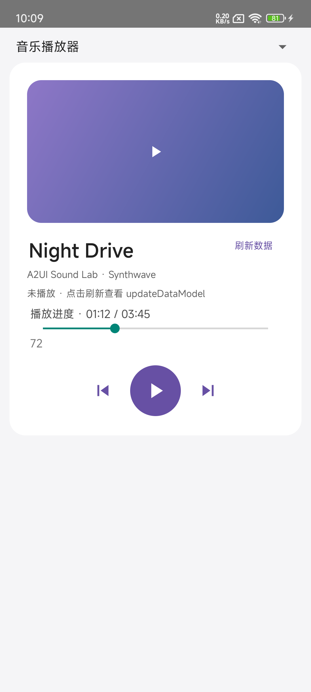
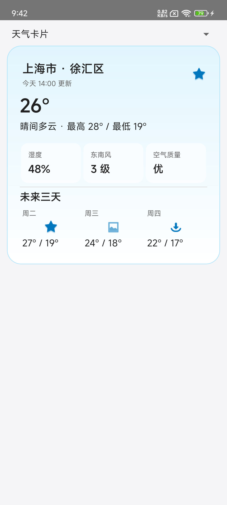
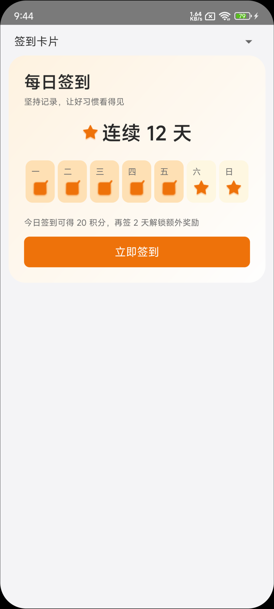
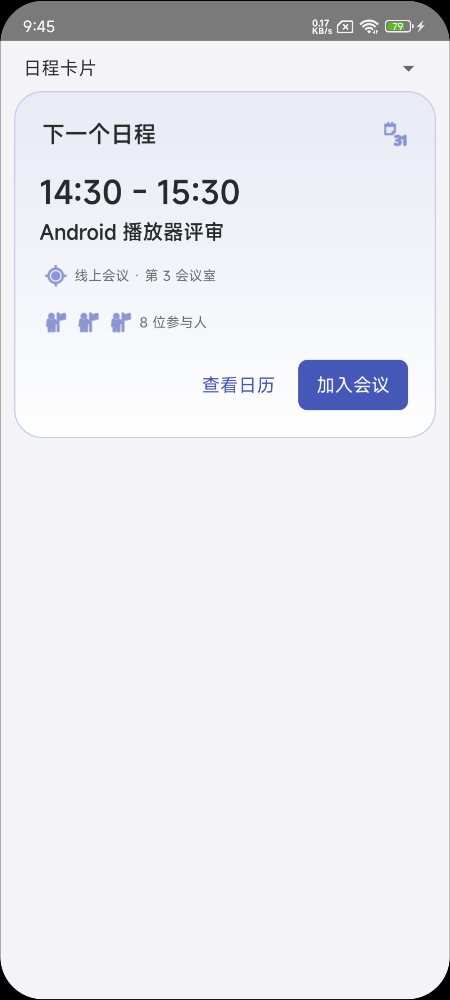
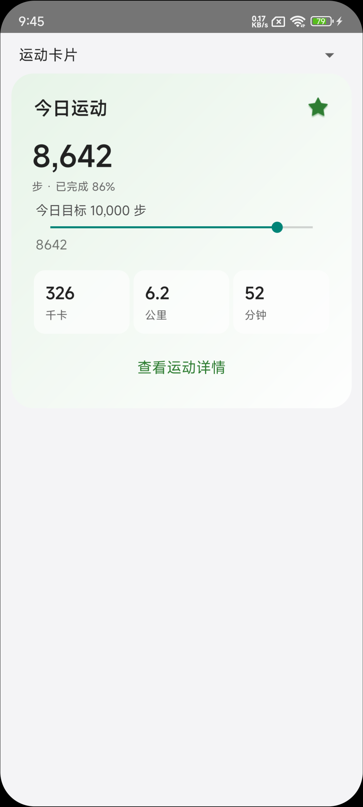
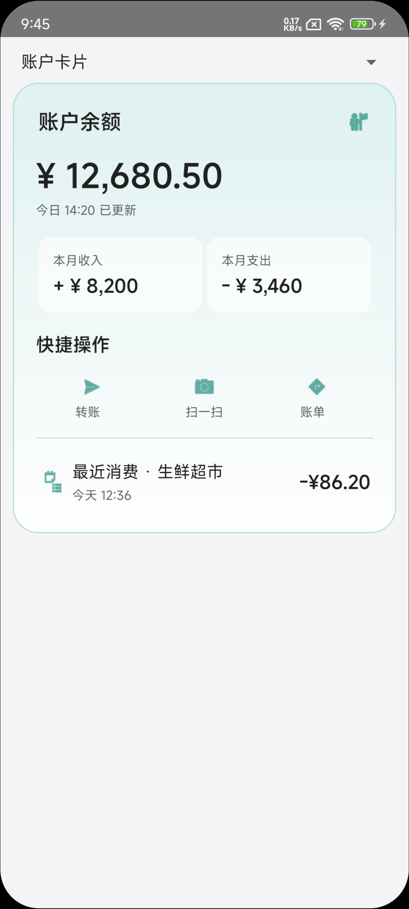
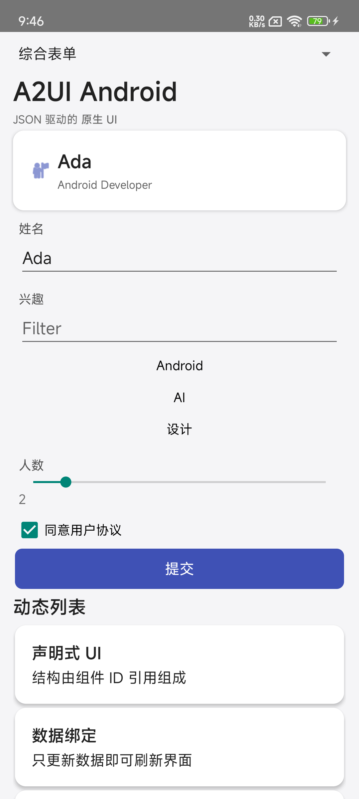
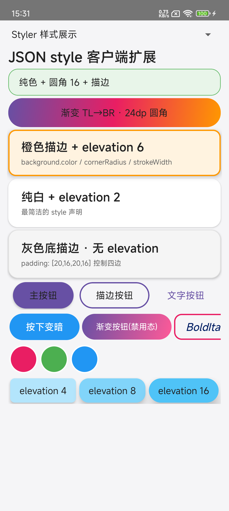

# A2UI Android v0.9.1

基于原生 Android View 的 A2UI 渲染库。传入 A2UI JSON、JSON 数组或 JSONL 消息，即可创建 Surface、渲染组件、处理数据绑定和交互 Action。

- 协议版本：**A2UI v0.9.1**
- Basic Catalog：18 类组件
- Java 包名：`org.a2ui.android.v0_9_1`
- 最低系统：Android 6.0（API 23）
- 编译版本：compileSdk 35
- 语言：Java 8
- JSON 解析：Gson 2.10.1

[](https://jitpack.io/#yaobin-kid/a2ui-android)

## 1. 已支持能力

| 能力 | 当前支持 |
| --- | --- |
| Surface 消息 | `createSurface`、`updateComponents`、`updateDataModel`、`deleteSurface` |
| 输入格式 | 单条 JSON、JSON 消息数组、JSONL |
| 数据绑定 | RFC 6901 JSON Pointer、字面量、列表项相对路径 |
| 函数 | 内置 `formatString`，支持注册自定义函数 |
| 交互 | Event Action、FunctionCall Action、输入双向写回、checks 校验 |
| 布局 | Row、Column、List、Card、Tabs、Modal |
| 展示 | Text、Image、Icon、Video、AudioPlayer、Divider |
| 输入 | Button、TextField、CheckBox、ChoicePicker、Slider、DateTimeInput |
| 样式 | JSON 背景/渐变/圆角/描边/间距，以及全局、类型、组件 ID 原生样式设置器 |
| 扩展 | 自定义组件渲染器、自定义图片加载器 |

当前实现面向 v0.9.1 Basic Catalog。带 `svgPath` 的 Icon 需要注册自定义渲染器，默认 Icon 使用内置名称映射。

## 2. Gradle 导入

### 2.1 通过 JitPack

在 `settings.gradle` 的仓库配置中加入 JitPack：

```groovy
dependencyResolutionManagement {
    repositories {
        google()
        mavenCentral()
        maven { url 'https://jitpack.io' }
    }
}
```

如果项目仍在根 `build.gradle` 配置仓库：

```groovy
allprojects {
    repositories {
        google()
        mavenCentral()
        maven { url 'https://jitpack.io' }
    }
}
```

然后在应用模块的 `build.gradle` 中添加：

```groovy
dependencies {
    implementation 'com.github.yaobin-kid:a2ui-android:v0.9.4'
}
```

Gson 已声明为 `api` 依赖，会随 AAR 的 Maven 元数据自动引入。JitPack 根据 GitHub 仓库和版本标签构建 AAR，不需要手动上传 AAR 文件。

### 2.2 直接使用本地 AAR

将构建出的 `a2ui-release.aar` 复制到应用的 `libs` 目录：

```groovy
dependencies {
    implementation files('libs/a2ui-release.aar')
    implementation 'com.google.code.gson:gson:2.10.1'
}
```

本地 `files` 方式不会读取 AAR 的 Maven 依赖，因此需要显式添加 Gson。

## 3. 快速开始

### 3.1 创建容器并渲染

```java
import org.a2ui.android.v0_9_1.A2uiView;

public class MainActivity extends Activity {
    @Override
    protected void onCreate(Bundle savedInstanceState) {
        super.onCreate(savedInstanceState);
        A2uiView a2uiView = new A2uiView(this);
        setContentView(a2uiView);
        a2uiView.render(json);
    }
}
```

也可以把 `A2uiView` 放进已有原生布局。渲染、样式注册和自定义组件注册后，已有 Surface 会按当前状态重新绘制。

### 3.2 最小 JSON 示例

```json
[
  {
    "version": "v0.9.1",
    "createSurface": {
      "surfaceId": "main",
      "catalogId": "https://a2ui.org/specification/v0_9_1/catalogs/basic/catalog.json",
      "theme": { "primaryColor": "#6750A4" },
      "sendDataModel": true
    }
  },
  {
    "version": "v0.9.1",
    "updateComponents": {
      "surfaceId": "main",
      "components": [
        {
          "id": "root",
          "component": "Card",
          "child": "content",
          "style": {
            "background": { "color": "#FFFFFFFF", "cornerRadius": 20 },
            "padding": 20
          }
        },
        { "id": "content", "component": "Text", "text": { "path": "/message" }, "variant": "h3" }
      ]
    }
  },
  {
    "version": "v0.9.1",
    "updateDataModel": {
      "surfaceId": "main",
      "value": { "message": "Hello A2UI v0.9.1" }
    }
  }
]
```

根组件 ID 必须为 `root`。组件通过 ID 引用，例如 `Card.child = "content"`。

`createSurface.theme.primaryColor` 是 A2UI v0.9.1 的主题字段，使用 `#RRGGBB` 或 `#AARRGGBB` 颜色值。它应用于 Icon、Button、Tabs，以及 TextField 聚焦边框、CheckBox/ChoicePicker 选中状态、Slider 进度与滑块、DateTimeInput 边框；未设置时使用默认靛蓝色 `#3F51B5`。

### 3.3 更新数据

收到按钮事件或服务端数据后，可以继续向同一个 Surface 发送 `updateDataModel`：

```java
a2uiView.render("{\"version\":\"v0.9.1\",\"updateDataModel\":{"
        + "\"surfaceId\":\"main\",\"value\":{\"message\":\"数据已更新\"}}}");
```

Sample 的音乐播放器演示了刷新、切歌和播放暂停时同时更新曲名、歌手、进度与图标，见 `sample/src/main/assets/music_player.json`。

### 3.4 Action 用法（Button 交互）

Button（以及 Modal 的 trigger）的 `action` 支持 **三种形式**，由组件被点击时触发。

#### 3.4.1 event —— 发送事件到宿主应用

最常用的形式。点击后封装成 `A2uiAction` 回调到宿主的 `A2uiActionListener`。

**JSON：**

```json
{
  "id": "submit",
  "component": "Button",
  "variant": "filled",
  "child": "submitText",
  "action": {
    "event": {
      "name": "submitForm",
      "context": {
        "email": "#/form/email",
        "nickname": "#/form/nickname",
        "agreed": "#/form/agreed"
      }
    }
  }
}
```

**JSON Pointer 数据绑定：** `context` 里的值可以是 `#/path/to/dataModel`，解析时会自动替换成 dataModel 中对应路径的值。上例中点击按钮时，`context.email` 会是当前 dataModel 里 `/form/email` 的实际值。

**Java 端接收：**

```java
a2uiView.setActionListener(action -> {
    // action.getName()          → "submitForm"
    // action.getSurfaceId()     → "main"
    // action.getSourceComponentId() → "submit"
    // action.getContext()       → {"email":"user@example.com","nickname":"kid","agreed":true}
    // action.getDataModel()     → 整个 dataModel 快照（需 createSurface.sendDataModel=true）
    JsonObject ctx = action.getContext();
    String email = ctx.get("email").getAsString();
    // 执行业务逻辑：网络请求、页面跳转、Toast……
    // 完成后可发送 updateDataModel 刷新界面
});
```

#### 3.4.2 functionCall —— 调用内置函数

`functionCall` **不经过宿主 ActionListener**，直接在 Surface 内部执行，常用于数值格式化、条件显示等纯逻辑。

**JSON：**

```json
{
  "id": "btn-format",
  "component": "Button",
  "variant": "bordered",
  "child": "btn-format-text",
  "action": {
    "functionCall": {
      "call": "formatCurrency",
      "args": { "value": "#/cart/total", "currency": "CNY" }
    }
  }
}
```

**内置函数列表：**

| 函数 | 说明 | args |
| --- | --- | --- |
| `formatString` | 字符串模板 | `template`（含 `{0}` `{1}`…）, `values`（数组） |
| `formatNumber` | 数字格式化 | `value`, `decimals`（可选）, `grouping`（可选） |
| `formatCurrency` | 货币格式化 | `value`, `currency`（ISO 4217 如 `CNY` `USD`）, `decimals`（可选） |
| `formatDate` | 日期格式化 | `value`（ISO 8601 或时间戳）, `pattern` |
| `pluralize` | 多语言复数 | `value`（数值）, `one`, `other`, `few` 等 |
| `required` | 非空校验 | `value` |
| `regex` | 正则校验 | `value`, `pattern` |
| `length` | 长度校验 | `value`, `min`（可选）, `max`（可选） |
| `numeric` | 数值范围校验 | `value`, `min`（可选）, `max`（可选） |
| `email` | 邮箱格式校验 | `value` |
| `openUrl` | 打开网页（需 Android 实现） | `url` |

**注册自定义函数：**

```java
a2uiView.registerFunction("myApiFetch", args -> {
    String endpoint = args.get("endpoint").getAsString();
    // 执行网络请求……
    return new JsonPrimitive(result);
});
```

#### 3.4.3 input —— 输入写回（TextField / CheckBox / ChoicePicker / Slider）

输入控件（**不是 Button**）的 `action` 使用 `input` 形式，将值写回 dataModel 指定路径。

**JSON：**

```json
{
  "id": "email-input",
  "component": "TextField",
  "binding": "#/form/email",
  "action": { "input": { "target": "#/form/email" } }
}
```

当用户输入或选中时，dataModel 的 `/form/email` 路径会被更新，并触发依赖该路径的所有组件重新渲染。

#### 3.4.4 三种 Action 对比

| 维度 | `event` | `functionCall` | `input` |
| --- | --- | --- | --- |
| 谁触发 | Button / Modal trigger | Button / 任意组件 | TextField / CheckBox / Slider |
| 执行方 | 宿主应用（Java 端） | Surface 内置或注册函数 | Surface 内部 |
| 结果 | 宿主决定做什么 | 返回值写入 dataModel（需显式绑定） | 自动写回 dataModel |
| JSON Pointer 支持 | `context` 内的路径自动解析 | `args` 内路径自动解析 | `binding` 自动解析 |

### 3.5 注册函数（扩展）

除了内置的 11 个函数，宿主可以注册自定义函数：

```java
a2uiView.registerFunction("greet", args -> {
    String name = args.get("name").getAsString();
    return new JsonPrimitive("Hello, " + name + "!");
});
```

JSON 中调用：

```json
{ "functionCall": { "call": "greet", "args": { "name": "#/user/name" } } }
```

## 4. 数据绑定（Data Model Binding）

每个 Surface 内部维护一个 JSON 对象 `dataModel`。组件的**支持动态值的属性**可以通过 `{ "path": "..." }` 绑定到 dataModel 的某个字段；当 `updateDataModel` 更新该字段时，所有绑定它的组件会自动重新渲染。

### 4.1 path 的定义：RFC 6901 JSON Pointer

`path` 遵循 [RFC 6901 JSON Pointer](https://tools.ietf.org/html/rfc6901) 语法：

| 写法 | 含义 |
| --- | --- |
| `""` 或 `"/"` | 整个 dataModel 根对象 |
| `"/message"` | 根对象的 `message` 字段 |
| `"/user/name"` | `user` 对象下的 `name` 字段 |
| `"/items/0/title"` | 数组 `items` 第 0 项的 `title` |
| `"/items/-/title"` | 数组末尾追加项的 `title`（仅 set 时） |

**转义规则：** JSON Pointer 中 `~` 必须写成 `~0`，`/` 必须写成 `~1`。例如键名 `a/b` 对应路径 `/a~1b`，键名 `x~y` 对应 `/x~0y`。

`path` 既可以写**绝对路径**（以 `/` 开头），也可以写**相对路径**（不带 `/`，仅在列表模板项内有效，见 4.4）。

### 4.2 在组件属性中绑定 dataModel

只要组件 schema 声明某属性为 dynamic，就可以用 `{ "path": "/xxx" }` 替代字面量。例如 `Text.text`、`Image.url`、`Icon.name`、`Slider.value`、`Button.child` 引用的子组件等。

```json
{ "id": "greeting", "component": "Text", "text": { "path": "/message" }, "variant": "h3" }
```

渲染时，引擎会取 `dataModel.message` 的值作为文本。如果该路径不存在，返回 `null`，属性按空值处理（不抛异常）。

#### `#/path` 字符串简写（event context / functionCall args 专用）

在 `action.event.context` 和 `action.functionCall.args` 中，除了 `{ "path": "/xxx" }` 对象形式，还可以用更简洁的 **`#/path` 字符串**形式。`#` 后面的部分是 JSON Pointer，引擎会自动替换成 dataModel 中对应路径的当前值：

```json
{
  "action": {
    "event": {
      "name": "submitForm",
      "context": {
        "email": "#/form/email",
        "agreed": "#/form/agreed"
      }
    }
  }
}
```

点击按钮时，`action.getContext().get("email")` 拿到的是 `dataModel.form.email` 的实际值（如 `"user@example.com"`），而不是字符串 `"#/form/email"`。

> 💡 `#/path` 字符串语法**仅用于** event context 和 functionCall args；组件属性（如 `Text.text`）必须用 `{ "path": "/xxx" }` 对象形式。

### 4.3 updateDataModel 的三种用法

`updateDataModel` 消息体有三个字段：`surfaceId`（必填）、`path`（可选）、`value`（可选）。

#### 用法一：整体替换 dataModel（不传 path）

`path` 省略或为 `""`/`"/"` 时，`value` 必须是 JSON 对象，**整体替换**整个 dataModel：

```json
{
  "version": "v0.9.1",
  "updateDataModel": {
    "surfaceId": "main",
    "value": {
      "message": "Hello A2UI",
      "user": { "name": "kid", "age": 18 },
      "items": [ { "title": "任务一" }, { "title": "任务二" } ]
    }
  }
}
```

#### 用法二：更新指定路径（path + value）

只更新 dataModel 的某个子路径，其余字段不变。中间路径不存在时会**自动创建**：

```json
{
  "version": "v0.9.1",
  "updateDataModel": {
    "surfaceId": "main",
    "path": "/user/age",
    "value": 19
  }
}
```

也可以向数组追加元素（用 `-` 索引）：

```json
{
  "version": "v0.9.1",
  "updateDataModel": {
    "surfaceId": "main",
    "path": "/items/-",
    "value": { "title": "任务三" }
  }
}
```

#### 用法三：删除指定路径（有 path，无 value）

消息体只有 `surfaceId` 和 `path`、没有 `value` 时，删除该路径：

```json
{
  "version": "v0.9.1",
  "updateDataModel": {
    "surfaceId": "main",
    "path": "/user/age"
  }
}
```

> 💡 **关键行为：** `updateDataModel` 后，引擎会对整个 Surface 重新渲染。绑定到已变更路径（及其父路径、子路径）的组件都会拿到新值。

### 4.4 列表动态渲染 + 相对路径

`Row`/`Column`/`List` 的 `children` 属性支持 `{ "path": "/数组路径", "componentId": "模板组件ID" }`：引擎会遍历数组，为每项生成一个模板组件实例。

在模板组件内部，绑定 `path` 可以写**相对路径**（不带 `/`），会自动拼接到当前数组项的绝对路径前。

```json
[
  {
    "id": "todo-list",
    "component": "Column",
    "children": { "path": "/items", "componentId": "todo-item" }
  },
  {
    "id": "todo-item",
    "component": "Row",
    "children": ["todo-check", "todo-title"]
  },
  {
    "id": "todo-check",
    "component": "CheckBox",
    "label": "",
    "value": { "path": "done" }
  },
  {
    "id": "todo-title",
    "component": "Text",
    "text": { "path": "title" },
    "variant": "body"
  }
]
```

当 dataModel 为：

```json
{ "items": [ { "title": "买牛奶", "done": true }, { "title": "写代码", "done": false } ] }
```

渲染结果是两行列，每行一个 CheckBox + Text。模板内的 `done` 和 `title` 是相对路径，分别解析为 `/items/0/done`、`/items/0/title`、`/items/1/done`、`/items/1/title`。

### 4.5 事件 context 中的 `#/path` 引用

Button `action.event.context` 里的值可以写 `#/path/to/dataModel`（注意带 `#` 前缀），点击时自动替换为 dataModel 中对应路径的当前值。详见 3.4.1。

### 4.6 完整示例：待办清单（数据绑定 + 动态列表 + updateDataModel）

下面这个 demo 展示了：创建 Surface → 用绑定渲染列表 → 点击按钮追加一条任务。

```json
[
  {
    "version": "v0.9.1",
    "createSurface": {
      "surfaceId": "todo",
      "catalogId": "https://a2ui.org/specification/v0_9_1/catalogs/basic/catalog.json",
      "theme": { "primaryColor": "#6750A4" },
      "sendDataModel": true
    }
  },
  {
    "version": "v0.9.1",
    "updateComponents": {
      "surfaceId": "todo",
      "components": [
        {
          "id": "root",
          "component": "Card",
          "child": "layout",
          "style": { "background": { "color": "#FFFFFFFF", "cornerRadius": 16 }, "padding": 16 }
        },
        {
          "id": "layout",
          "component": "Column",
          "children": ["header", "list", "add-btn"]
        },
        {
          "id": "header",
          "component": "Text",
          "text": { "path": "/title" },
          "variant": "h4"
        },
        {
          "id": "list",
          "component": "Column",
          "children": { "path": "/items", "componentId": "row" }
        },
        {
          "id": "row",
          "component": "Row",
          "children": ["check", "title"]
        },
        {
          "id": "check",
          "component": "CheckBox",
          "label": "",
          "value": { "path": "done" }
        },
        {
          "id": "title",
          "component": "Text",
          "text": { "path": "title" },
          "variant": "body"
        },
        {
          "id": "add-btn",
          "component": "Button",
          "variant": "filled",
          "child": "add-btn-text",
          "action": { "event": { "name": "addTodo" } }
        },
        { "id": "add-btn-text", "component": "Text", "text": "新增一条", "variant": "body" }
      ]
    }
  },
  {
    "version": "v0.9.1",
    "updateDataModel": {
      "surfaceId": "todo",
      "value": {
        "title": "今日待办",
        "items": [
          { "title": "买牛奶", "done": true },
          { "title": "写代码", "done": false }
        ]
      }
    }
  }
]
```

Java 端收到 `addTodo` 事件后，向数组追加一项：

```java
a2uiView.setActionListener(action -> {
    if ("addTodo".equals(action.getName())) {
        a2uiView.render("{\"version\":\"v0.9.1\",\"updateDataModel\":{"
                + "\"surfaceId\":\"todo\","
                + "\"path\":\"/items/-\","
                + "\"value\":{\"title\":\"新任务\",\"done\":false}}}");
    }
});
```

也可以一次性整体替换 `items`：

```java
a2uiView.render("{\"version\":\"v0.9.1\",\"updateDataModel\":{"
        + "\"surfaceId\":\"todo\","
        + "\"value\":{\"title\":\"今日待办\",\"items\":["
        + "{\"title\":\"买牛奶\",\"done\":true},"
        + "{\"title\":\"写代码\",\"done\":true},"
        + "{\"title\":\"新任务\",\"done\":false}]}}");
```

Sample 中的 `music_player.json`（曲名/歌手/进度绑定）、`weather_card.json`（三日预报动态列表）、`fitness_card.json`（步数 Slider 绑定）都是真实的 dataModel 绑定示例。

## 5. registerComponentStyler 使用方法

`A2uiComponentStyler` 可以直接修改组件最外层的原生 View，适合设置文字颜色、背景、尺寸、间距和具体 Android 控件属性。

### 5.1 全局样式

没有更具体的设置器时使用：

```java
a2uiView.setGlobalComponentStyler((view, component, context) -> {
    if (view instanceof TextView) {
        ((TextView) view).setIncludeFontPadding(false);
    }
});
```

### 5.2 按组件类型注册

```java
a2uiView.registerComponentTypeStyler("Button", (view, component, context) -> {
    view.setMinimumHeight(dp(48));
});
```

### 5.3 为指定组件 ID 注册私有样式

只作用于 Surface `demo` 中的 `music-play`：

```java
a2uiView.registerComponentStyler("demo", "music-play", (view, component, context) -> {
    GradientDrawable background = new GradientDrawable();
    background.setColor(Color.rgb(103, 80, 164));
    background.setCornerRadius(dp(32));
    view.setBackground(background);
    view.setPadding(dp(16), dp(16), dp(16), dp(16));
});
```

省略 `surfaceId` 时，作用于所有 Surface 中同 ID 的组件：

```java
a2uiView.registerComponentStyler("music-play", styler);
```

### 5.4 优先级与执行规则

```text
指定 Surface + 组件 ID 设置器
    > 跨 Surface 的组件 ID 设置器
    > 组件类型设置器
    > 全局设置器
```

同一个组件只执行优先级最高的一个设置器，不会串联执行全部设置器。JSON `style` 总是先应用，所以原生设置器可以覆盖声明式样式。

- 类型或 ID 注册方法传入 `null`：移除对应设置器。
- `setGlobalComponentStyler(null)`：清除全局设置器。
- `view`：实际原生组件，可强转为 `TextView`、`ImageView`、`LinearLayout` 等。
- `component`：当前组件的原始 JSON。
- `context`：可获取 Surface、数据作用域、Android Context，或解析动态值。

### 5.5 在自定义 Styler 中加载网络图片

自定义渲染器或 Styler 可以通过 `context.loadImage(url, imageView)` 复用当前 `A2uiView` 的图片加载器，无需重复实现网络请求和缓存。

Sample 的 `weather_image_card.json` 演示了整卡网络图片背景：为 `weather-photo-card` 注册私有 Styler，将背景 `ImageView` 放在内容下层，并使用 `ImageView.ScaleType.FIT_XY` 按卡片宽高拉伸填满。完整实现见 `sample/src/main/java/org/a2ui/android/v0_9_1/sample/MainActivity.java`。

## 6. JSON style 样式（Android 客户端扩展）

> ⚠️ **`style` 不是 A2UI v0.9.1 协议定义的属性**。协议的 `common_types.json` 里组件基类只有 `id` 和 `accessibility`，每个组件 schema 声明 `"unevaluatedProperties": false`，要求协议外字段**静默忽略**。
>
> 本库的 `ComponentStyleApplier` 在"静默忽略"的基础上**额外解析** style 字段并应用到原生 View。解析失败仍静默忽略，不会破坏协议兼容性——一个严格协议合规的客户端可以完全不解析 style，视觉效果交由原生 Styler 实现。

### 6.1 颜色格式与单位

**颜色格式：**

| 格式 | 示例 | 说明 |
| --- | --- | --- |
| `#RRGGBB` | `#FF6750A4` | 不透明纯色，Android 会自动把 6 位解释为不透明 |
| `#AARRGGBB` | `#80FF6750A4` | 带 alpha 通道，`80` = 50% 透明 |
| `#00RRGGBB` | `#00000000` | 完全透明 |

**尺寸单位：**

| 字段 | 单位 | 说明 |
| --- | --- | --- |
| `padding` / `paddingHorizontal` / `paddingVertical` | **dp** | Density Independent Pixels，自动适配屏幕密度 |
| `cornerRadius` / `strokeWidth` | **dp** | 同上 |
| `elevation` | **dp** | Android elevation 本身用 px，库内部自动转换 |
| `textSize` | **sp** | Scale Independent Pixels，跟随系统字体设置 |
| `alpha` | 0.0～1.0 | 无单位 |

### 6.2 组件差异：style 适用范围

| 组件 | background | stateStyles | textColor/textSize/textStyle | padding | elevation | 备注 |
| --- | --- | --- | --- | --- | --- | --- |
| Button | ✅ | ✅ 支持 pressed/disabled/checked/focused | ✅ 递归应用到子 TextView | ✅ | ✅ | variant 为 `filled`/`bordered`/`borderless` 时会叠加 ripple，`stateStyles.pressed` 可覆盖 |
| Card | ✅ | ✅ | — | ✅ | ✅ | 最外层容器 |
| Row / Column | ✅ | — | — | ✅ | ✅ | 布局容器 |
| Text | ✅ | — | ✅ 自身即是 TextView | ✅ | ✅ | textColor 会覆盖默认文字色 |
| TextField | ✅ | ✅ disabled | — | ✅ | ✅ | 背景加在 TextInputLayout，颜色应用到子 EditText |
| Image | ✅ | — | — | ✅ | ✅ | 背景叠加在图片后面，可做 placeholder |
| Slider | ✅ | — | — | ✅ | ✅ | 背景加在 ProgressBar 外层容器 |
| CheckBox | ✅ | ✅ checked/disabled | — | ✅ | — | 背景加在 CompoundButton 容器 |
| ChoicePicker | ✅ | ✅ checked/disabled | — | ✅ | ✅ | 背景加在选择器外层 |
| DateTimeInput | ✅ | ✅ disabled | — | ✅ | ✅ | TextInputLayout + 图标容器 |
| Tabs | ✅ | ✅ selected | ✅ 选中 tab 子 TextView | ✅ | ✅ | — |
| Icon | ✅ | — | — | ✅ | ✅ | 背景加在 ImageView 外层 |
| Divider | ✅ | — | — | — | — | 覆盖颜色需注意 divider 高度只有 1dp |
| Modal | ✅ | — | — | — | ✅ | 背景加在 AlertDialog Builder |

### 6.3 style 顶层属性

| 属性 | 类型 | 默认值 | 适用组件 | 说明 |
| --- | --- | --- | --- | --- |
| `background` | color string 或 object | 透明 | 全部 | 字符串是纯色简写 `"#FF112233"`；对象见下 |
| `stateStyles` | object | 无 | Button / Tabs / CheckBox / ChoicePicker / DateTimeInput / TextField | 按下/选中/禁用/焦点态的背景覆盖 |
| `textColor` | color string | 组件默认 | Text / Button / Tabs | **递归查找子 TextView** 并应用 |
| `textSize` | number | 组件默认 | Text / Button / Tabs | 单位 sp，递归应用到子 TextView |
| `textStyle` | `normal` / `bold` / `italic` / `boldItalic` | `normal` | Text / Button / Tabs | 递归应用 |
| `padding` | number 或 `[left, top, right, bottom]` | 组件默认 | 全部 | 单个数四边相同；数组顺序 `[left, top, right, bottom]` |
| `paddingHorizontal` | number | — | 全部 | 覆盖左右（dp） |
| `paddingVertical` | number | — | 全部 | 覆盖上下（dp） |
| `elevation` | number | 组件默认 | 大部分容器 | dp |
| `alpha` | number | 1.0 | 全部 | 0～1 |
| `clipToOutline` | boolean | 有圆角时 true | 大部分容器 | 是否按背景轮廓裁剪子内容（如图片超出圆角时） |

### 6.4 stateStyles 对象

| key | Android state | 适用组件 | 说明 |
| --- | --- | --- | --- |
| `"pressed"` | `state_pressed` | Button（所有 variant） | 手指按住/触摸中 |
| `"checked"` | `state_checked` | CheckBox / ChoicePicker / Tabs（选中态） | 选中状态 |
| `"disabled"` | `state_enabled = false` | 所有组件 | `component.enabled = false` 时显示 |
| `"focused"` | `state_focused` | Button / 输入控件 | 获得焦点（遥控器/键盘导航） |
| （默认） | 空 state | — | 未匹配任何状态时回退到 `background` 属性 |

**实现机制：** Android `StateListDrawable` 是 first-match，因此 stateStyles 内部按 **disabled → pressed → checked → focused → default** 顺序添加。如果同时按下且禁用，disabled 优先显示。

**stateStyles 中的 background**：每个 key 的值是完整的 background 对象——可以是纯色简写字符串，也可以是带渐变/圆角/描边的对象。与顶层 `background` 对象完全相同的规格。

### 6.5 background 对象

| 属性 | 类型 | 默认值 | 说明 |
| --- | --- | --- | --- |
| `color` | color string | `"#00000000"` | 纯色填充。未设置 `gradientColors` 时使用 |
| `gradientColors` | color string 数组 | 无 | 至少 **2 种**颜色；设置后替代纯色。所有数组元素必须是有效的 `#RRGGBB` 或 `#AARRGGBB` |
| `gradientOrientation` | 八方向枚举 | `"TOP_BOTTOM"` | 见下方枚举表 |
| `cornerRadius` | number | `0` | 四角**统一**圆角半径（dp）。当前不支持四角分别设置不同半径 |
| `strokeWidth` | number | `0` | 描边宽度（dp）。>0 时显示描边 |
| `strokeColor` | color string | `"#FF000000"`（黑色） | 描边颜色 |
| `clipToOutline` | boolean | 有圆角时自动 true | 是否按圆角轮廓裁剪子内容（如 Image 超出圆角区域） |

**渐变方向枚举：**

| 值 | 方向 | 示意 |
| --- | --- | --- |
| `TOP_BOTTOM`（默认） | 上→下 | ↓ |
| `BOTTOM_TOP` | 下→上 | ↑ |
| `LEFT_RIGHT` | 左→右 | → |
| `RIGHT_LEFT` | 右→左 | ← |
| `TL_BR` | 左上→右下 | ↘ |
| `BR_TL` | 右下→左上 | ↖ |
| `TR_BL` | 右上→左下 | ↙ |
| `BL_TR` | 左下→右上 | ↗ |

### 6.6 完整示例

#### 6.6.1 渐变 Button + stateStyles + textStyle

```json
{
  "id": "my-button",
  "component": "Button",
  "variant": "filled",
  "child": "btn-text",
  "action": { "event": { "name": "submit" } },
  "style": {
    "background": {
      "gradientColors": ["#FF6750A4", "#FF3D5A98"],
      "gradientOrientation": "TL_BR",
      "cornerRadius": 24,
      "strokeWidth": 2,
      "strokeColor": "#40FFFFFF",
      "clipToOutline": true
    },
    "stateStyles": {
      "pressed":  { "color": "#FF3D2B5B", "cornerRadius": 24 },
      "disabled": { "color": "#FFBDBDBD", "cornerRadius": 24 }
    },
    "textColor": "#FFFFFFFF",
    "textSize": 16,
    "textStyle": "bold",
    "padding": [28, 12, 28, 12],
    "elevation": 4
  }
}
```

#### 6.6.2 纯色 Card + 圆角 + 内边距 + 阴影

```json
{
  "id": "weather-card",
  "component": "Card",
  "child": "weather-content",
  "style": {
    "background": {
      "gradientColors": ["#FFE1F5FE", "#FFFFFFFF"],
      "gradientOrientation": "TOP_BOTTOM",
      "cornerRadius": 24,
      "strokeWidth": 1,
      "strokeColor": "#FFB3E5FC"
    },
    "padding": [20, 20, 20, 20],
    "elevation": 4
  }
}
```

#### 6.6.3 描边 Button（outline）+ BoldItalic

```json
{
  "id": "btn-outline",
  "component": "Button",
  "variant": "bordered",
  "child": "btn-outline-text",
  "action": { "event": { "name": "reset" } },
  "style": {
    "background": {
      "color": "#00000000",
      "cornerRadius": 12,
      "strokeWidth": 2,
      "strokeColor": "#FFE91E63"
    },
    "stateStyles": {
      "pressed": { "color": "#FFE91E63", "cornerRadius": 12, "strokeWidth": 2, "strokeColor": "#FFC2185B" }
    },
    "textColor": "#FFE91E63",
    "textSize": 18,
    "textStyle": "boldItalic",
    "padding": [20, 10, 20, 10]
  }
}
```

#### 6.6.4 简洁 Text style

```json
{
  "id": "title",
  "component": "Text",
  "text": "大标题",
  "variant": "h3",
  "style": {
    "textColor": "#FF1A1A1A",
    "textSize": 24,
    "textStyle": "bold",
    "background": { "color": "#FFF5F5F5", "cornerRadius": 8 },
    "padding": [16, 8, 16, 8]
  }
}
```

#### 6.6.5 stateStyles 简写（纯色）

stateStyles 的每个状态值可以是**颜色字符串简写**，不必写完整对象：

```json
{
  "style": {
    "background": { "color": "#FF2196F3", "cornerRadius": 24 },
    "stateStyles": {
      "pressed": "#FF1976D2",
      "disabled": "#FF90CAF9"
    }
  }
}
```

### 6.7 优先级与执行顺序

```
执行顺序：
  ComponentStyleApplier.apply()  →  Java Styler 回调
        ↓                                    ↓
    JSON style 先应用                   registerComponentStyler(surfaceId, id)  ← 最高
                                         registerComponentStyler(id)
                                         registerComponentTypeStyler(type)
                                         setGlobalComponentStyler()          ← 最低

如果同一属性（如 background）同时在 JSON style 和 Java Styler 中设置，
Styler 后执行 → Styler 覆盖 JSON style。
```

### 6.8 静默失败保证

style 是客户端扩展。以下情况**不会抛异常**，组件正常渲染：

| 情况 | 处理 |
| --- | --- |
| style 字段缺失或为 null | 跳过，应用组件默认样式 |
| style 类型错误（如 `"style": 42`） | 跳过 |
| background.color 不是合法颜色（如 `"red"`） | 抛 `NumberFormatException`，被 try/catch 吞掉，背景不变 |
| gradientColors 少于 2 项 | 退化到纯色填充 |
| stateStyles 中某个 state 非法 | 跳过该 state，默认态仍有效 |
| textStyle 值非法 | 忽略，保持 normal |

### 6.9 JSON style 能做 vs 不能做

| 能做（style 声明式） | 不能做（必须用 Java Styler） | 原因 |
| --- | --- | --- |
| 纯色背景 `background.color` | 加载远程图片当背景 | JSON 协议没有 URL 字段 |
| 八方向渐变 `gradientColors + gradientOrientation` | 圆形形状 `GradientDrawable.setShape(OVAL)` | style 只能设 `cornerRadius`，无法设形状类型 |
| 按下/选中/禁用/焦点态背景切换 `stateStyles` | 自定义 Typeface（字体文件） | `Typeface.createFromAsset()` 必须 Java 层 |
| 圆角/描边（宽度+颜色） | ImageView placeholder / 资源映射 | 需要调用 `getResources().getDrawable()` |
| padding（四边或水平/垂直） | 动态尺寸（如 `wrap_content` 宽度依赖） | JSON style 不影响 LayoutParams |
| elevation / alpha | — | — |
| clipToOutline 裁剪 | — | — |
| textColor / textSize / textStyle | — | — |

**JSON style 做不到的——必须用原生 Styler**：

| 场景 | 代码 |
| --- | --- |
| 加载网络图片当背景（需 FrameLayout 叠 ImageView） | 见 `weather-photo-card` 实现 |
| 加载原生 vector drawable | 见 `music-previous-icon` |
| 圆形形状 `setShape(OVAL)` | 见 Avatar 样式 |
| 自定义字体、字号、文字颜色、粗体 | `((TextView) view).setTypeface(...)` |
| ImageView placeholder | `context.loadImage(url, view)` |

```java
a2uiView.registerComponentStyler("demo", "weather-photo-card", (view, component, context) -> {
    FrameLayout card = (FrameLayout) view;
    ImageView background = new ImageView(this);
    background.setScaleType(ImageView.ScaleType.FIT_XY);
    card.addView(background, 0, new FrameLayout.LayoutParams(
            ViewGroup.LayoutParams.MATCH_PARENT, ViewGroup.LayoutParams.MATCH_PARENT));
    context.loadImage("https://example.com/bg.png", background);
});
```

## 7. 组件属性概览

所有组件都具有 `id`、`component`，以及可选的 `accessibility`。完整可选值、默认值、校验和绑定说明见 [组件属性详细文档](docs/components-and-styling.md)。

| 组件 | 主要属性 |
| --- | --- |
| `Text` | `text`、`variant` |
| `Image` | `url`、`description`、`fit`、`variant` |
| `Icon` | `name` |
| `Video` | `url` |
| `AudioPlayer` | `url`、`description` |
| `Row` | `children`、`justify`、`align` |
| `Column` | `children`、`justify`、`align` |
| `List` | `children`、`direction` |
| `Card` | `child` |
| `Tabs` | `tabs[{title, child}]` |
| `Modal` | `trigger`、`content` |
| `Divider` | `axis` |
| `Button` | `child`、`variant`、`action` |
| `TextField` | `label`、`value`、`variant`、`validationRegexp`、`checks` |
| `CheckBox` | `label`、`value`、`checks` |
| `ChoicePicker` | `label`、`options`、`value`、`variant`、`displayStyle`、`filterable`、`checks` |
| `Slider` | `label`、`min`、`max`、`value`、`checks` |
| `DateTimeInput` | `label`、`value`、`enableDate`、`enableTime`、`min`、`max`、`checks` |

支持动态值的属性可以使用 `{ "path": "/user/name" }`；动态列表使用 `{ "path": "/items", "componentId": "item" }`。

## 8. 业务 Demo 效果图

<table>
  <tr>
    <td align="center"><strong>音乐播放器</strong><br></td>
    <td align="center"><strong>天气卡片</strong><br></td>
  </tr>
  <tr>
    <td align="center"><strong>签到卡片</strong><br></td>
    <td align="center"><strong>日程卡片</strong><br></td>
  </tr>
  <tr>
    <td align="center"><strong>运动卡片</strong><br></td>
    <td align="center"><strong>账户卡片</strong><br></td>
  </tr>
  <tr>
    <td align="center"><strong>综合表单</strong><br></td>
    <td align="center"><strong>Styler 样式展示</strong><br></td>
  </tr>
</table>

对应 JSON 位于 `sample/src/main/assets`：

| 文件 | 示例 |
| --- | --- |
| `music_player.json` | 播放器布局、矢量控制按钮、数据刷新 |
| `weather_card.json` | 天气指标、动态三日预报 |
| `checkin_card.json` | 每周签到状态、签到 Action |
| `schedule_card.json` | 日程、参与人、会议操作 |
| `fitness_card.json` | 步数、进度、运动指标 |
| `payment_card.json` | 余额、收支、快捷操作 |
| `sample.json` | 输入绑定、校验、动态商品列表 |
| `weather_image_card.json` | 天气卡片副本，通过私有 Styler 和 `FIT_XY` 使用整卡拉伸图片背景 |
| `media_showcase.json` | Image、Icon、Video、AudioPlayer 等媒体组件 |
| `layout_showcase.json` | Row、Column、List、Card、Tabs、Modal、Divider |
| `input_controls.json` | TextField 四种变体、ChoicePicker、Slider、CheckBox、DateTimeInput 和 Button |
| `style_showcase.json` | JSON style 客户端扩展全部能力展示：纯色/渐变背景、八方向、stateStyles（pressed/disabled/checked）、textColor/textSize/textStyle、padding、elevation、描边/圆角 |

Sample 共提供十一个可切换示例，新增三个组件示例合起来覆盖 Basic Catalog 全部 18 类组件。

## 9. 构建与发布

```bash
# 运行测试
./gradlew :a2ui:testDebugUnitTest

# 构建 AAR 与 Sample APK
./gradlew :a2ui:assembleRelease :sample:assembleDebug

# 验证 Maven 发布内容
./gradlew :a2ui:publishReleasePublicationToMavenLocal
```

产物：

- AAR：`a2ui/build/outputs/aar/a2ui-release.aar`
- Sample APK：`sample/build/outputs/apk/debug/sample-debug.apk`

发布 JitPack 时，将包含 `jitpack.yml` 和 `maven-publish` 配置的代码推送到 GitHub，再创建版本标签：

```bash
git tag -a v0.9.4 -m "Android renderer v0.9.4 (A2UI v0.9.1)"
git push origin v0.9.4
```

随后可在 [JitPack 构建页面](https://jitpack.io/#yaobin-kid/a2ui-android) 查看版本构建状态。

## 10. 源码结构

```text
a2ui/                 A2UI Android 库
  src/main/java/      协议、数据绑定、渲染器、样式 API
  src/test/java/      JVM 与 Robolectric 测试
sample/               十一个可切换示例
  src/main/assets/    A2UI JSON
  src/main/res/       Sample 矢量图标
docs/                 详细组件文档与真机效果图
```
